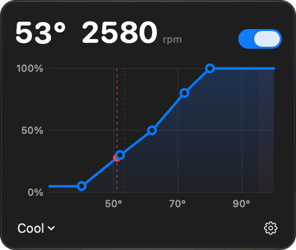

# FanCurve

A tiny menu bar app that lets you set your own fan curve on Apple Silicon MacBook Pros.
It reads the average temperature of all CPU cores and sets the fan speed from the curve you draw.

<p align="center"></p>

- **One popover, nothing else.** Temperature, fan speed, an on/off switch, the curve and the profile.
- **Drag the curve.** Double-click empty space to add a point, double-click a point to remove it.
- **Profiles.** Quiet, Balanced, Cool, Cold and Very Cold, plus your own: edit any curve and press ✓
  to save it; rename or delete your own profiles from the ⚙︎ menu.
- **Thermal inertia.** A short burst of load (a test run, a build) heats the chip in a second,
  but the case stays cold. The curve follows a smoothed temperature, so the fans speed up over
  about a minute instead of jumping to full speed. See [Fan response](#fan-response).
- **⚙︎ menu.** Fan response, show or hide the temperature next to the menu bar icon, open at login, quit.
- **Safe by default.** See [Safety](#safety).
- **15 languages**, chosen from your system language: English, Chinese (Simplified), Hindi, Spanish,
  French, Arabic, Bengali, Portuguese, Russian, Urdu, Indonesian, German, Japanese, Turkish, Korean.

> Works on MacBook Pro with M-series chips (tested on M5 Pro, macOS 27). Macs without fans,
> such as MacBook Air, have nothing to control.

## Install

FanCurve is built from source. You need Xcode or the Xcode Command Line Tools.

```sh
git clone https://github.com/mketau-spm/mac-fan-control.git
cd mac-fan-control
scripts/build.sh --install
open /Applications/FanCurve.app
```

`scripts/build.sh` compiles the app and the helper, runs all tests, signs the bundle
(with your Apple Development certificate if you have one, otherwise ad-hoc) and, with `--install`,
copies it to `/Applications`.

On first launch click the fan icon in the menu bar, then **Allow fan control**.
macOS asks for your password once to install the helper that talks to the fans.

## How it works

| Part | Installed to | Role |
|---|---|---|
| `App/` (SwiftUI) | `/Applications/FanCurve.app` | Menu bar popover, profiles in `~/Library/Application Support/FanCurve/profiles.json` |
| `Helper/fancurved.m` | `/Library/PrivilegedHelperTools/com.fancurve.helper` | `launchd` daemon running as root: reads temperatures (IOHID) and sets fans (SMC keys `F<n>md` / `F<n>Md`, `F<n>Tg`) |
| Unix socket | `/var/run/fancurve.sock` | App ↔ helper, one JSON object per line. Mode `0600`, owner = the user who installed it, peer uid checked |

The helper only drives the fans **while the app is connected**. With no app connected it sleeps
and leaves the fans to macOS.

## Fan response

The curve does not use the raw core temperature. It uses a smoothed one (an exponential moving
average): the red dot on the chart, while a faint dashed line shows the real temperature.

| Setting | Heating time constant | 30 s of 40 → 85 °C load reaches |
|---|---|---|
| Fast | 10 s | ≈ 83 °C |
| Smooth (default) | 45 s | ≈ 62 °C |
| Very Smooth | 90 s | ≈ 53 °C |

Cooling is smoothed the same way. Above 80 °C the time constant shrinks smoothly, down to a fifth
of itself near 95 °C, so real heat is followed sooner without a sudden jump.

On top of that the fan level itself changes by at most +2 %/s and −1 %/s: going from idle to full
speed takes about 50 s, so you hear the fans grow instead of switch on.

## Safety

- Fan speed always stays between Apple's minimum and maximum for each fan.
- Average core temperature ≥ 95 °C or any core ≥ 105 °C → fans go to 100 % at once, and stay
  there until the average is below 90 °C and every core below 100 °C. This uses the real
  temperature, never the smoothed one. Apple Silicon cores run at 95–100 °C under heavy load
  by design, and the chip slows itself down before it overheats.
- The curve can never go down: hotter never means slower.
- Speed changes are smoothed: up to +2 %/s, down to −1 %/s.
- New targets are written at most every 3 s and only when they change by ≥ 3 %.
  The safety rule, the first write, a new curve and reaching min/max skip this.
- Fans go back to macOS when the app quits or crashes, the switch is off, sensors are missing,
  the SMC refuses a write, or the helper gets a signal or restarts.

## Tests

```sh
scripts/build.sh
```

- `Tests/helper_test.py` — end-to-end tests of the helper in `--fake` mode (no root, simulated fans).
- `Tests/CurveTests.swift` — curve math, presets, profile storage, the display filter.

Run the UI against simulated fans:

```sh
build/fancurved --fake --socket /tmp/fc.sock &
open -n build/FanCurve.app --env FANCURVE_SOCKET=/tmp/fc.sock
```

Try another language: `open -n build/FanCurve.app --args -AppleLanguages "(ja)"`.

## Uninstall

```sh
sudo sh Helper/uninstall-helper.sh
rm -rf /Applications/FanCurve.app
```

## Disclaimer

FanCurve writes to the System Management Controller through undocumented keys. It never sets a fan
outside Apple's own limits and always hands the fans back to macOS when it stops, but you use it at
your own risk.

## License

[MIT](LICENSE)
